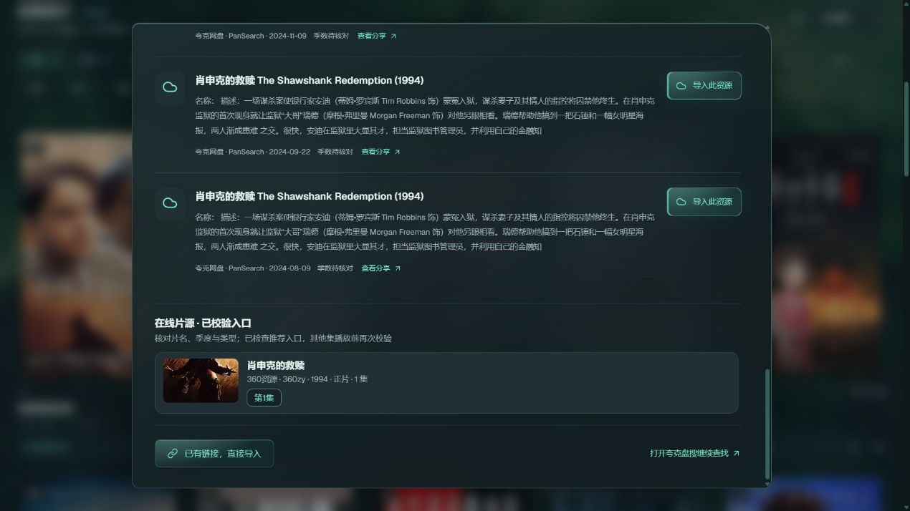
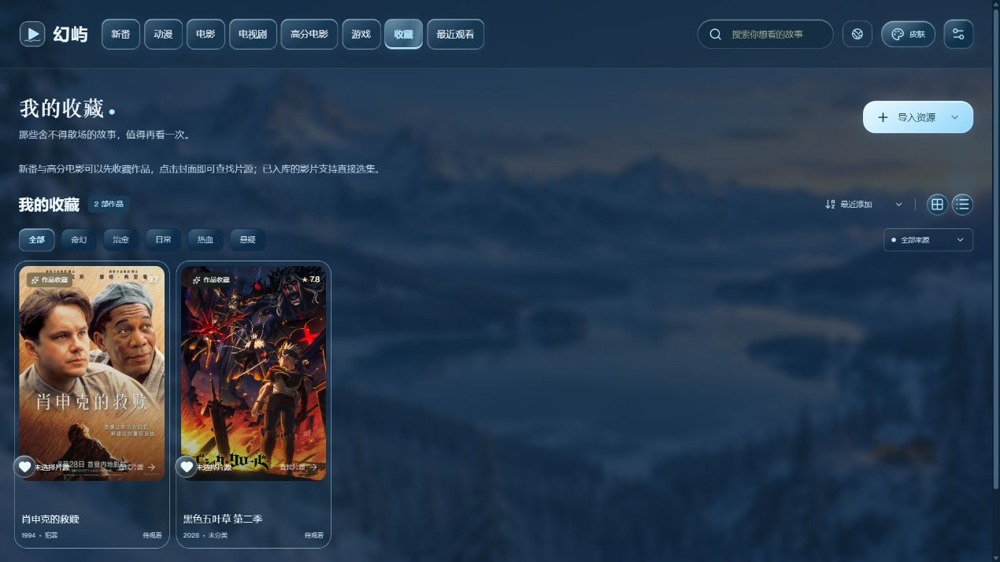
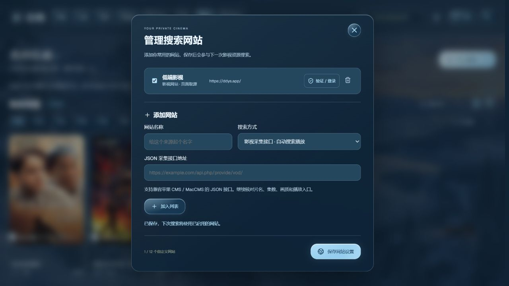
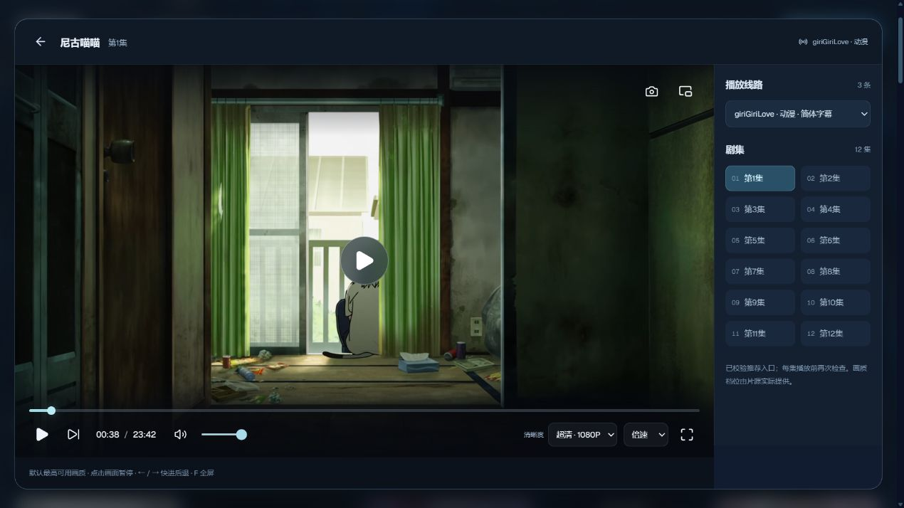
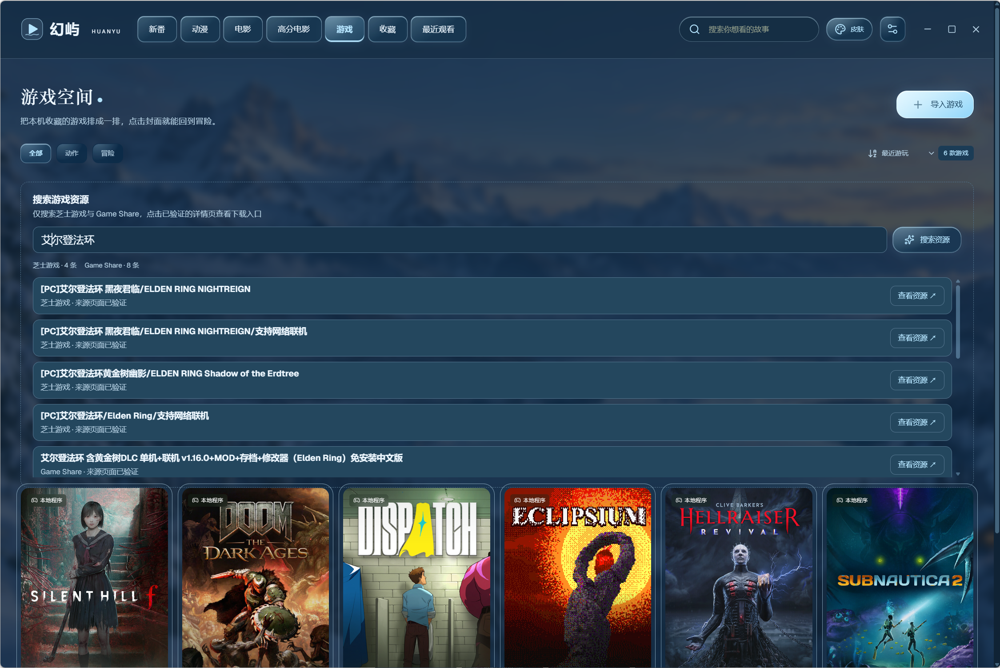

<div align="center">

# 幻屿 · HUANYU

**你的私人放映室 —— 一款运行于 Windows 的本地影视 + 游戏管理软件**

[](../../releases)
[](../../releases)
[](https://www.electronjs.org/)
[](LICENSE)

**季度新番 · 动漫、电影与电视剧 · 豆瓣高分片单 · 本地游戏 · 自定义皮肤**

[下载安装包](../../releases/latest) · [便携版](../../releases/latest) · [功能特性](#features) · [截图预览](#screenshots)

</div>

---

<a id="features"></a>

## ✨ 功能特性

| 功能 | 可以做什么 |
| --- | --- |
| 季度新番 | 浏览当季与历史季度片单，搜索作品，关联本地视频或查找夸克资源与在线片源 |
| 私人影视库 | 统一「片库」管理已导入和在线播放的作品，按动漫、电影、电视剧筛选；保存进度、收藏与字幕设置 |
| 电视剧 | 独立追剧片库，导入夸克分享或本地剧集；按完整剧名与季数搜索在线线路，校验后直接选集播放 |
| 高分电影 | 独立浏览豆瓣 Top250 片单，按中文名 / 原名搜索、按类型筛选，再查找播放资源 |
| 作品收藏 | 新番和高分电影可以先收藏再选片源，在收藏页保留封面、评分与介绍，点击卡片继续找资源 |
| 自定义搜索网站 | 添加影视网页、MacCMS 接口或夸克分享搜索站；支持启停和人工验证后的网页取源 |
| 游戏空间 | 导入并启动本机游戏，匹配 Steam 资料，仅从芝士游戏与 Game Share 搜索游戏资源 |
| 场景与外观 | 七款内置皮肤，以及导入图片、自动取色、换图即生效的自定义皮肤 |

<a id="screenshots"></a>

## 📸 截图预览

### 📺 季度新番

幻屿首页聚焦 **Bangumi 当季新番**：高分轮播 Banner、评分与开播时间，点击作品即可查找网盘资源、在线片源或关联本地视频。

顶部搜索框横跨 **2023 年 1 月开播至今的全部新番**，跨季度一键查找；片单标题右侧的**季度选择框**可以回看近 4 年的任意历史季度（如 2025 年 10 月新番），点击「刷新新番」会自动跟进最新季度。

季度更新会重新核对已知作品的开播资料，补回资料源搜索索引遗漏的条目；例如《FX战士久留美》按 2026 年 10 月 1 日的开播日期收录于十月片单。已改期、非 TV / WEB 或不属于该季度的作品仍会排除。


*（截图：霓虹夜城皮肤下的季度片单）*

### 🎞️ 豆瓣高分电影

**「高分电影」负责发现，「片库」管理已保存作品。** 独立页面展示内置豆瓣 Top250 片单，与私人片库分开；推荐作品也可先收藏，稍后再选择片源。顶部不再重复设置「动漫」「电影」入口，原有作品都保留在「片库」的分类筛选中。

- **250 部电影、27 种类型**：剧情、科幻、喜剧、悬疑、动画等，一部电影可归属多个类型。
- **按片名找电影**：顶部搜索框支持中文名与原名，例如「星际穿越」或 `Interstellar`；电影库中的关键词也可带入高分片单继续查找。
- **按喜好浏览**：类型筛选、榜单顺序 / 评分优先 / 年份排序，以及分页浏览。
- **从推荐到片库**：点击海报或「查找播放资源」，导入后归入电影区并保留封面、评分与作品资料。


### 🔎 电影片源搜索

从推荐电影直接进入片源搜索，将**夸克网盘结果与在线片源**集中展示：可以查看分享、导入资源，或展开在线片源选择集数播放。下面以《肖申克的救赎》为例。



在线搜索会核对作品名称、季数和影视类型，过滤解说、预告与无关条目。展示前检查推荐入口的播放列表和首个媒体分段，每集播放前再次校验；失败的入口会暂时隐藏，播放器内可以直接换线路。第三方来源仍可能随时变化，不能保证每部作品都能搜到可用的在线片源。

动漫来源参考 [Kazumi 的「搜索 → 选集 → 播放」规则流程](https://kazumi.app/docs/rules/introduce-rules/)，接入了 [giriGiriLove API 来源](https://github.com/Predidit/KazumiRules/blob/main/giriGiriLove.json)与 [AGE 动漫的搜索、选集流程](https://github.com/Predidit/KazumiRules/blob/main/AGE.json)。giriGiriLove 区分简体、繁体字幕线路；AGE 从所选集数的页面读取实际播放地址，继续校验入口与真实分辨率，不会把无法打开的页面当作可播放资源。幻屿目前并不支持导入所有 Kazumi 规则；相关 MIT 许可保留在 `licenses/KAZUMI-RULES-LICENSE.txt` 及安装包的第三方许可说明中。

影视搜索统一先展示在线片源，夸克分享位于下方。**动漫在线播放仅搜索 giriGiriLove、DDYS、MG动漫、Mute动漫、路漫漫和 AGE动漫六站**，不再混入其他影视采集站；电影、电视剧仍可使用原有来源及自定义网站。同一来源内优先更高清晰度，播放器默认使用所选线路的最高可用画质。

动漫搜索会尝试短片名、别名、繁简译名与罗马数字季数，匹配后再次核对季度，避免把第二季混入第三季。已实测《无职转生》第三季在 DDYS、giriGiriLove、MG、Mute 的 1920×1080 入口；分季从第一集开始。网站暂不可用、无可用线路和等待人工验证分别显示。需要验证时会打开对应网页，用户完成并关闭后自动重试；也可在「搜索网站」里手动打开内置来源的验证窗口。

### ❤️ 先收藏，稍后看

新番、高分电影卡片与作品资源窗口均可点击「收藏」。尚未导入视频的作品也会带着封面、评分和简介出现在收藏页，点击卡片即可继续查找片源或关联本地、夸克资源；导入同一作品时会继承收藏状态。



### 🌐 添加资源搜索网站

点击顶部搜索框旁或资源搜索窗口中的「搜索网站」，填写名称、搜索方式和地址，加入列表后点击「保存网站设置」。可以随时启用、停用或移除，设置保存在本机。

| 搜索方式 | 用途 |
| --- | --- |
| 影视网站 · 页面取源 | 读取支持的页面播放器和公开播放列表，在幻屿内选季、选集播放 |
| 影视采集接口 | 接入兼容 MacCMS / 苹果 CMS 的 JSON 接口，搜索后校验在线线路 |
| 夸克资源网页 | 在包含 `{query}` 的搜索地址中查询关键词，读取公开分享链接 |
| 网页搜索入口 | 显示原站搜索入口，点击前往网站查看；此方式不自动提取视频 |

**DDYS 示例：** 选择「影视网站 · 页面取源」，地址填写 `https://ddys.app/`。保存后可点击「验证 / 登录」，在独立窗口中自行完成网站要求的验证。后续搜索遇到访问验证时，幻屿会自动打开验证窗口；完成验证并关闭该窗口后，当前搜索会自动重试。多个请求只打开一个对应网站的验证窗口，并避免关闭后反复弹出。验证会话按网站独立保存在本机，之后可以复用。已实测该站《肖申克的救赎》1080P 播放，以及《药屋少女的呢喃》第三季从第一集开始的分季列表。

页面取源当前支持 DDYS 播放列表与可识别的公开视频地址，不保证任意网站都兼容；不绕过会员线路、付费限制或人工访问验证。新增网站用于影视资源搜索，游戏搜索仍只使用芝士游戏和 Game Share。



### 🎬 影视库与播放

**「电视剧」是独立的追剧页面。** 在顶部导航进入后，可粘贴夸克分享链接导入整部电视剧，也支持本地文件夹；在在线搜索框输入完整剧名（多季作品带上季数），即可查找并播放通过入口检查的电视剧线路。同名电影、动漫和解说不会作为电视剧展示；没有通过校验的来源会显示无可用结果或暂不可用。在线播放沿用清晰度、分集、换线路、倍速与全屏控制，默认选择最高可用画质。已导入作品可在详情页更改为「电视剧」分类，AI 自动识别为电视剧时也会进入该区域。

在线搜索默认优先 **1080P / 2K / 4K**，过滤已经确认低于超清的线路，并显示实际分辨率；电视剧页面可关闭「超清优先」查看其他画质。会读取视频分段或 MP4 索引确认分辨率，无法识别的来源明确标注「清晰度待确认」；视频分段参数优先于播放列表上的清晰度标记。宽银幕电影以分辨率档位分类，同时保留 `1920×800` 等真实尺寸。缺集或无效地址不会导致后面的集数错位。来源不提供更高画质时，软件不会把低清视频标成超清。

电视剧的「搜索播放资源」同时查询在线线路与夸克公开分享，接入[夸克盘搜](https://www.zhongchuangwl.com/)、PanSearch 和 PanSou。较慢的网站结果会自动补充，无需重复搜索；分享结果标注的 4K / 1080P 仅表示发布者说明，实际画质以导入文件为准。在线来源补充速播、红牛，支持公共 HTTPS CDN 使用的媒体端口，继续校验每集的播放内容；来源未收录、接口不可用、画质不符和线路失效分别提示。升级后启动器会核对后台版本，并正常关闭可验证的旧后台，避免新界面继续调用旧搜索服务。

夸克结果还会在后台抽查优先候选的分享目录，移除已确认失效或空目录的分享，读到视频文件时显示提示。检查使用独立的匿名会话，不会转存文件；未完成验证的结果仍在导入时验证。

所有在线影视入口统一支持 **「收藏到片库」**。从新番、高分电影、电视剧或作品资源窗口开始在线播放时，会先保存封面、分集与线路，实际观看后写入进度并进入「最近观看」；退出时保存最后进度，点击最近观看的卡片即可续播，重启后仍然保留。同一作品的多条线路合并保存，切换线路保留进度；原地址失效时会尝试向原来源刷新线路，无需每次按名称重新搜索。全屏时统一使用底部控制栏的全屏按钮，也可按 Esc / F 退出，已移除左上角重复的旧版退出按钮。

- 导入本地视频（自动整理分集）或 **夸克网盘分享链接**，在线播放无需下载
- 默认播放最高可用画质；在播放器控制栏选择原画 / 4K / 超清 / 高清 / 标清等片源实际提供的档位，切换时保留进度与暂停状态。单一画质线路仅展示真实档位。
- 新播放器提供进度、倍速、音量、画中画、截图与全屏控制；在线片源可在播放器右侧切换线路和集数。
- 多季度作品按文件名、季文件夹或作品名识别季度，每季从第一集重新编号，支持按季选集；原文件、分集 ID 与观看进度保留。
- 内外挂字幕：自动搜索匹配、内嵌字幕提取，字幕大小与位置可调整
- 观看进度、收藏、继续观看一一记录，详情页可编辑资料、更换封面
- AI 资料管家（可选，绑定 DeepSeek）：自动识别作品并补全封面与简介


**播放器实景：** 已校验的动漫线路、1080P 清晰度、分集选择与播放控制。



### 🎮 游戏空间

导入本机游戏（`.exe` 或 `.lnk` 快捷方式），点击封面即可启动：

- 自动从 Steam 获取封面与中文简介，也可手动上传 / 编辑
- 游玩次数、最近游玩时间记录，最近玩过的排最前
- 游戏文件保留原位，仅记录启动路径
- **Steam 资料匹配**：启动程序名是简称（如 `SHF.exe`）搜不到正确游戏时，在详情页输入游戏名称（如 `Silent Hill f`），从候选中一键应用正确的封面与简介


#### 只从两个游戏网站搜索

输入游戏名，例如「艾尔登法环」，仅搜索 [芝士游戏](https://www.cheesegame.org/) 与 [Game Share](https://www.gameshare.cc/)：

- 按游戏标题匹配，过滤影视条目，并显示每个来源的结果数量。
- 返回前检查来源详情页，排除无法访问、下架或明确标记失效的页面。
- 没有找到就直接提示未找到，不再转向其他聚合来源。
- 点击「查看资源」进入原站详情页；详情页可访问不代表其网盘下载文件一定有效，具体下载入口与文件状态以原站为准。



### 🎨 场景皮肤与自定义背景

**七款内置场景 + 自定义皮肤**：晨雾青屿、蓝金流光、赤焰终端、翡翠幻墨、霓虹夜城、鎏金影厅、冰雪之境。

每套皮肤均配全屏场景背景、主题化滚动条与液态玻璃质感，明暗两种氛围随意切换；动态背景与玻璃效果也可单独开关。

**把喜欢的图片变成自己的皮肤：**

1. 点击右上角「皮肤」，选择「导入背景图」。
2. 导入 JPG、PNG 或 WebP 图片，软件自动压缩并提取配色，生成背景与主题颜色。
3. 图片上传完成后，背景、Banner 和皮肤预览立即更新，连续换图无需重启；外观设置会保存到下次打开。


<details>
<summary>展开查看七款内置皮肤的暗色效果</summary>

以下为内置场景效果示例；完整功能与新页面以本页上方截图为准。

| 蓝金流光（暗） | 赤焰终端（暗） |
| --- | --- |
|  |  |

| 翡翠幻墨（暗） | 霓虹夜城（暗） |
| --- | --- |
|  |  |

| 鎏金影厅（暗） | 冰雪之境（暗） |
| --- | --- |
|  |  |

**晨雾青屿（暗）**


</details>

## 🔒 隐私优先

- 媒体库、收藏、进度、游戏启动路径与加密凭据**保存在本机**，软件不上传整份片库
- 密钥经 Windows 当前用户加密存储（DPAPI）
- 安装包不含任何用户数据与密钥；卸载软件不会删除你的媒体库
- 获取作品资料、搜索资源与网盘播放会请求相应服务；启用 DeepSeek 后，会发送识别所需的作品名与视频文件名
- 自定义网站的搜索关键词会发送至所启用的网站；网站登录会话仅保存在本机隔离的浏览器目录中，不随安装包或仓库发布

## 📥 下载

前往 [Releases](../../releases/latest) 页面：

| 文件 | 说明 |
| --- | --- |
| `Huanyu-1.3.0-Setup.exe` | 标准安装向导：选择目录 → 安装 → 完成，含桌面快捷方式与卸载器 |
| `Huanyu-1.3.0-Portable.zip` | 免安装便携版：解压后运行 `幻屿.exe` 即可 |

安装向导每次都会显示安装位置选择页，可以选择其他盘符。安装程序按标准流程申请管理员权限，以支持 `Program Files` 等受保护目录；幻屿日常运行不要求管理员权限。

Windows 安装版和便携版的数据统一保存在 `%LOCALAPPDATA%\Huanyu\data`，不写入安装目录。旧版程序旁的媒体库、封面和加密凭据会在新用户目录尚无片库时复制迁移，原文件保留。卸载程序不会删除这份个人数据。

往届季度片单和跨季度搜索中的作品同样支持导入夸克资源、关联本地视频；导入时会保留所选作品的封面、简介等资料。历史片单会缓存到本机，重启后仍可使用。

重新打包使用 `npm run package:installer`，生成完整安装程序和标准 ZIP 便携包；默认输出到 `release/installer`，打包源不会包含个人数据。可通过 `HUANYU_INSTALLER_OUTPUT` 指定输出目录。

> 💡 安装 / 运行时若提示软件未知，选择「仍要运行」即可（个人项目未做代码签名）。

## 🚀 快速开始

1. 下载并安装（或解压便携版）
2. 启动幻屿 —— 服务与界面自动就绪
3. 顶部「导入资源」添加你的本地视频 / 夸克分享，「游戏」页导入本机游戏
4. 在「设置」中按需绑定 DeepSeek Key（AI 自动补全封面简介，可选）与夸克账号（在线播放）
5. 在「高分电影」按片名或类型挑选电影；在「游戏」页搜索两站资源，或用「皮肤 → 导入背景图」设置专属外观

## 🛠 技术栈

- **前端**：React 19 + Vite + TypeScript，无 UI 框架、手写 CSS 主题系统
- **后端**：Node.js 原生 `http` 模块（无框架），媒体流 Range 分发、HLS 代理
- **桌面**：Electron 45（自绘标题栏 + 主题化窗口按钮）
- **数据**：本地 JSON + 文件系统，原子写入
- **测试**：Node.js 内置 test runner，86 项自动化测试通过（含子测试）

```powershell
npm install        # 安装依赖
npm run dev        # 开发模式（前端热更新）
npm run build      # 构建前端
npm test           # 运行测试
npm run typecheck  # 类型检查
```

## 📜 使用许可与免责声明

完整条款见 [LICENSE](LICENSE)，要点如下：

**✅ 你可以**

- 免费下载、安装并在本机使用幻屿
- **原样分享**给他人（不修改、不收费、完整保留软件内的名称、图标与版权信息）

**⛔ 你不可以**

- 将本软件或其任何部分用于**任何商业用途**（出售、付费下载、捆绑销售、广告变现、商业演示等）
- **抄袭冒充**：将本软件的代码、界面、素材、文案声称为自己的作品
- 移除、修改或遮盖软件内的名称、图标与版权信息后分发
- 对软件修改、二次开发后公开分发衍生版本（个人学习修改仅限自用）

**⚠️ 免责声明**

- 本软件按"现状"提供，不附带任何明示或默示的担保
- 新番资料与海报来自 [Bangumi](https://bgm.tv)，高分电影片单与资料来自豆瓣，游戏资料来自 Steam 公开接口，版权归原权利方所有；夸克网盘功能基于其网页端公开接口，请遵守服务条款，播放质量与可用性取决于账号权限
- 对因使用或无法使用本软件产生的任何损失，作者不承担责任
- 违反上述条款将自动终止使用授权，作者保留追究责任的权利

## 📄 License

[幻屿使用许可与免责声明](LICENSE) © 2026 FineYi666 · 保留所有未明示授予的权利
