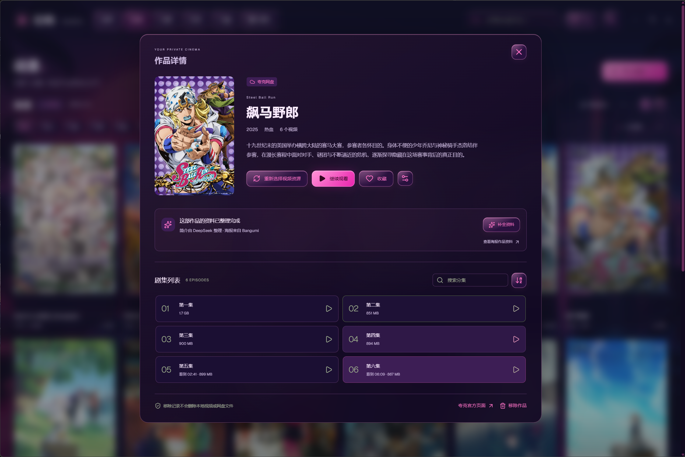
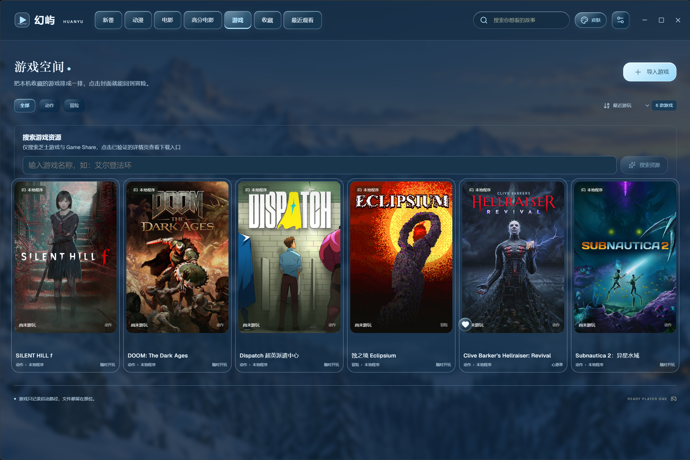
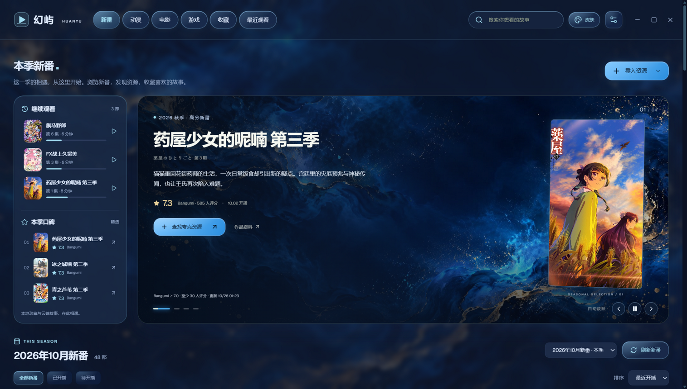
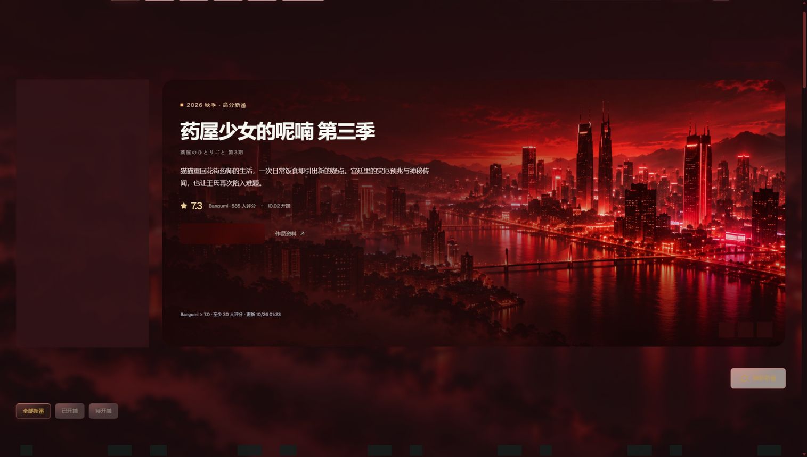
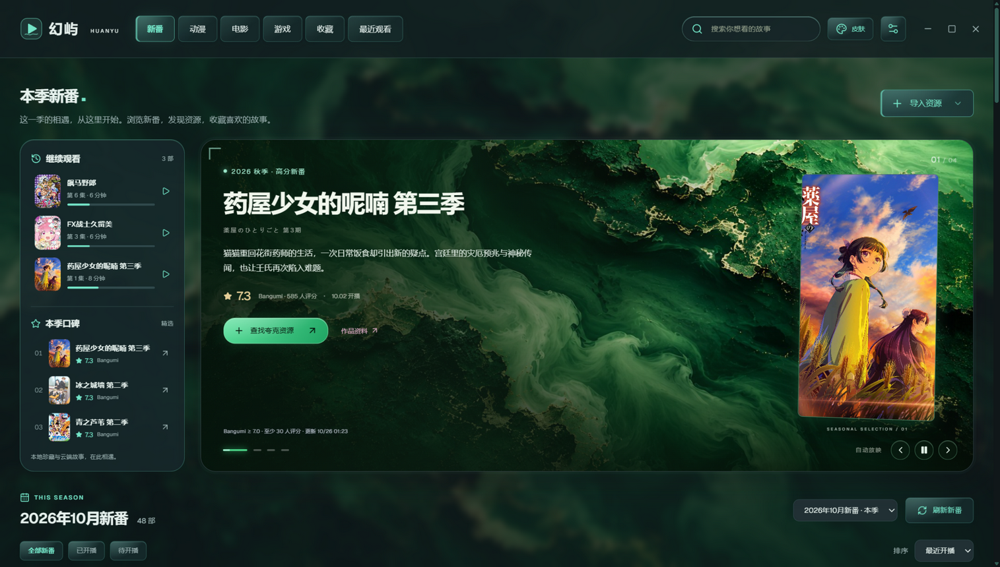
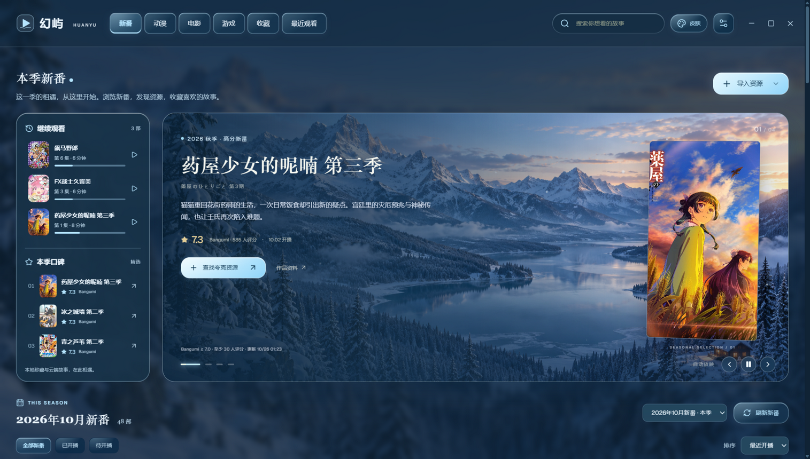
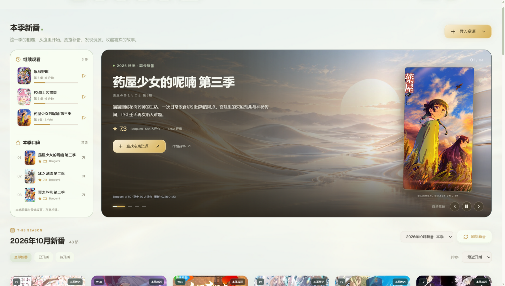
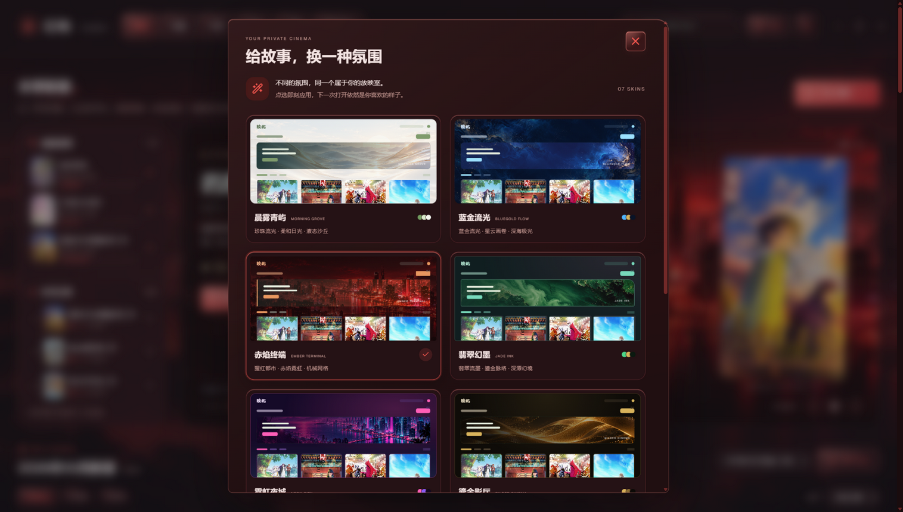

<div align="center">

# 幻屿 · HUANYU

**你的私人放映室 —— 一款运行于 Windows 的本地影视 + 游戏管理软件**

[](../../releases)
[](../../releases)
[](https://www.electronjs.org/)
[](LICENSE)

**季度新番 · 动漫 · 电影 · 本地游戏 · 全部收藏在你自己的电脑上**

[下载安装包](../../releases/latest) · [便携版](../../releases/latest) · [功能特性](#-功能特性) · [截图预览](#-截图预览)

---

## 📺 季度新番

幻屿首页聚焦 **Bangumi 当季新番**：高分轮播 banner、评分与开播时间、一部点击即可查找网盘资源或关联本地视频。

顶部搜索框横跨 **2023 年 1 月开播至今的全部新番**，跨季度一键查找；片单标题右侧的**季度选择框**可以回看近 4 年的任意历史季度（如 2025 年 10 月新番），点击「刷新新番」会自动跟进最新季度。


*（截图：霓虹夜城皮肤下的季度片单）*

## 🎬 影视库与播放

- 导入本地视频（自动整理分集）或 **夸克网盘分享链接**，在线播放无需下载
- 原画 / 4K / 2K 多档画质自动选择，HLS 流媒体代理播放
- 内外挂字幕：自动搜索匹配、内嵌字幕提取、样式（大小 / 位置 / 颜色）自定义
- 观看进度、收藏、继续观看一一记录，详情页可编辑资料、更换封面
- AI 资料管家（可选，绑定 DeepSeek）：自动识别作品并补全封面与简介



## 🎮 游戏空间

导入本机游戏（`.exe` 或 `.lnk` 快捷方式），点击封面即可启动：

- 自动从 Steam 获取封面与中文简介，也可手动上传 / 编辑
- 游玩次数、最近游玩时间记录，最近玩过的排最前
- 游戏文件保留原位，仅记录启动路径
- **Steam 资料匹配**：启动程序名是简称（如 `SHF.exe`）搜不到正确游戏时，在详情页输入游戏名称（如 `Silent Hill f`），从候选中一键应用正确的封面与简介



## 🎨 七款场景皮肤

晨雾青屿 · 蓝金流光 · 赤焰终端 · 翡翠幻墨 · 霓虹夜城 · 鎏金影厅 · 冰雪之境

每套皮肤均配全屏场景背景、主题化滚动条与液态玻璃质感，明暗两种氛围随意切换：

全部皮肤均以暗色氛围呈现：

| 蓝金流光（暗） | 赤焰终端（暗） |
| --- | --- |
|  |  |

| 翡翠幻墨（暗） | 霓虹夜城（暗） |
| --- | --- |
|  |  |

| 鎏金影厅（暗） | 冰雪之境（暗） |
| --- | --- |
|  |  |

| 晨雾青屿（暗） | 皮肤选择器一览 |
| --- | --- |
|  |  |

## 🔒 隐私优先

- 所有数据（媒体库、收藏、进度、游戏、密钥）**只保存在本机**，无任何遥测与上传
- 密钥经 Windows 当前用户加密存储（DPAPI）
- 安装包不含任何用户数据与密钥；卸载软件不会删除你的媒体库

## 📥 下载

前往 [Releases](../../releases/latest) 页面：

| 文件 | 说明 |
| --- | --- |
| `Huanyu-1.3.0-Setup.exe` | 标准安装向导：选择目录 → 安装 → 完成，含桌面快捷方式与卸载器 |
| `Huanyu-1.3.0-Portable.zip` | 免安装便携版：解压后运行 `幻屿.exe` 即可 |

安装向导每次都会显示安装位置选择页，可以选择其他盘符。安装程序按标准流程申请管理员权限，以支持 `Program Files` 等受保护目录；幻屿日常运行不要求管理员权限。

Windows 安装版和便携版的数据统一保存在 `%LOCALAPPDATA%\Huanyu\data`，不写入安装目录。旧版程序旁的媒体库、封面和加密凭据会在新用户目录尚无片库时复制迁移，原文件保留。卸载程序不会删除这份个人数据。

重新打包使用 `npm run package:installer`，生成完整安装程序和标准 ZIP 便携包；默认输出到 `release/installer`，打包源不会包含个人数据。可通过 `HUANYU_INSTALLER_OUTPUT` 指定输出目录。

> 💡 安装 / 运行时若提示软件未知，选择「仍要运行」即可（个人项目未做代码签名）。

## 🚀 快速开始

1. 下载并安装（或解压便携版）
2. 启动幻屿 —— 服务与界面自动就绪
3. 顶部「导入资源」添加你的本地视频 / 夸克分享，「游戏」页导入本机游戏
4. 在「设置」中按需绑定 DeepSeek Key（AI 自动补全封面简介，可选）与夸克账号（在线播放）

## 🛠 技术栈

- **前端**：React 19 + Vite + TypeScript，无 UI 框架、手写 CSS 主题系统
- **后端**：Node.js 原生 `http` 模块（无框架），媒体流 Range 分发、HLS 代理
- **桌面**：Electron 45（自绘标题栏 + 主题化窗口按钮）
- **数据**：本地 JSON + 文件系统，原子写入
- **测试**：Node.js 内置 test runner，70 个自动化用例

```powershell
npm install        # 安装依赖
npm run dev        # 开发模式（前端热更新）
npm run build      # 构建前端
npm test           # 运行测试
npm run typecheck  # 类型检查
```

## 📜 使用许可与免责声明

完整条款见 [LICENSE](LICENSE)，要点如下：

**✅ 你可以**

- 免费下载、安装并在本机使用幻屿
- **原样分享**给他人（不修改、不收费、完整保留软件内的名称、图标与版权信息）

**⛔ 你不可以**

- 将本软件或其任何部分用于**任何商业用途**（出售、付费下载、捆绑销售、广告变现、商业演示等）
- **抄袭冒充**：将本软件的代码、界面、素材、文案声称为自己的作品
- 移除、修改或遮盖软件内的名称、图标与版权信息后分发
- 对软件修改、二次开发后公开分发衍生版本（个人学习修改仅限自用）

**⚠️ 免责声明**

- 本软件按"现状"提供，不附带任何明示或默示的担保
- 新番资料与海报来自 [Bangumi](https://bgm.tv)、游戏资料来自 Steam 公开接口，版权归原权利方所有；夸克网盘功能基于其网页端公开接口，请遵守服务条款，播放质量与可用性取决于账号权限
- 对因使用或无法使用本软件产生的任何损失，作者不承担责任
- 违反上述条款将自动终止使用授权，作者保留追究责任的权利

## 📄 License

[幻屿使用许可与免责声明](LICENSE) © 2026 FineYi666 · 保留所有未明示授予的权利
